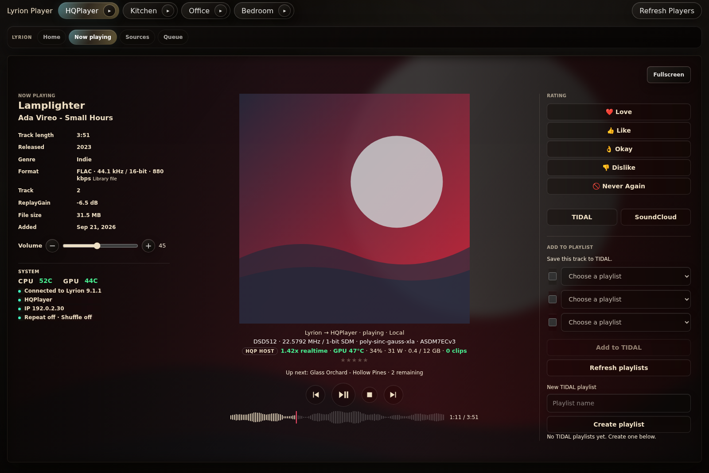

# The Rabbit Hole (guyp2k fork)

> **This is a fork, not the original project.** The Rabbit Hole is written by
> [darthspaders](https://github.com/darthspaders) and lives at
> [darthspaders/RoonAI](https://github.com/darthspaders/RoonAI). All credit for
> the app, its discovery engine and its Roon integration goes to him. This fork
> adds Lyrion, HQPlayer and interface changes on top of his work. Please report
> problems with this fork here, not upstream.

Discussion: [Roon Community thread](https://community.roonlabs.com/t/326019).
The original project's thread is [here](https://community.roonlabs.com/t/321144).

## Screenshots

Roon Now Playing (Obsidian & Copper theme):


Lyrion Now Playing, with the same layout:



The player card, opened from the ▸ on a room's pill or by tapping the album art, on a desktop and on a phone:

<p>
  
  
</p>

The screenshots use made-up tracks, rooms and addresses. For a section-by-section
walk through the changes, with more screenshots, see the [feature tour](docs/FEATURES.md).

## What this fork changes

Built on upstream commit `f0b1e81` (0.2.2). Most of these changes are also
offered upstream as pull requests.

- **Lyrion player:** styled to match the Roon player, with a Home tab (new music,
  favorites, explore), track and file details from LMS, ratings, a Setup menu
  and folding Sources lists. One unanswered Roon call no longer freezes the
  Lyrion controls.
- **Now Playing:** source format and playback chain under the album art,
  HQPlayer's output rate under the art for HQPlayer zones, a volume control,
  rating stars, system temperatures, and a waveform seek bar on both players
  (drawn from the LMS library file with FFmpeg). Under the art, an Up next line
  sits above round back, play/pause, stop and next buttons and a short seek bar.
- **HQP host line:** for an HQPlayer machine that runs the optional
  [HQP host monitor](integrations/hqp-host-monitor/README.md), a line under the
  HQPlayer line with realtime factor, GPU temperature, load, power and memory,
  and clips, coloured by limits (`HQP_HOST_MONITORS`).
- **Playback System row:** Roon zones as pills, plus optional links to the
  HQPlayer web interface, HQPTuner, HQPweb and Rouen.
- **Player card:** a ▸ on every Roon zone and Lyrion player pill (or a tap on
  the album art) opens that room's card: art, track, seek, back / play-pause /
  stop / next, and volume with mute, without switching the page to that room.
- **Themes:** Original, Obsidian & Copper, Roon Dark, Roon Light, Dark Orange,
  Graphite & Brass and Miyara, picked in Settings (`UI_THEME` sets the default).
- **Discovery fixes:** artist-led searches are checked against the planned
  artists, bare descriptor echoes and karaoke backing tracks are rejected, and
  Last.fm relatives of the searched artist are kept.
- **Layout:** foldable cards and panels, a header logo in the theme's colours,
  and a favicon.
- **Unraid:** a published image and an Unraid template. The image hands its data
  folder to `PUID`/`PGID`, so a fresh appdata folder works without fixing
  permissions by hand. Without `PUID`/`PGID` it runs as `node` (1000), as upstream does.

The full list is in the commit history after `f0b1e81`. New settings are
documented in `.env.example`.

## Install on Unraid

The image is published to `ghcr.io/guyp2k/rabbithole-fork` after every green CI
run on `main`. To install it from the template, run this in the Unraid terminal:

```sh
wget -O /boot/config/plugins/dockerMan/templates-user/my-RabbitHole-Fork.xml \
  https://raw.githubusercontent.com/guyp2k/RabbitHole-Fork/main/unraid/RabbitHole-Fork.xml
```

Then open **Docker > Add Container**, pick **RabbitHole-Fork** from the template
list, fill in your Lyrion and model addresses, and apply. Open the web UI and
enable **The Rabbit Hole** in **Roon > Settings > Extensions**. Data is kept in
`/mnt/user/appdata/rabbithole-fork`, owned by `PUID`/`PGID` (99:100 by default).

**Security:** like upstream, the web UI and API have no login. Run it on a
trusted LAN only and never expose port 3777 to the internet.

## License

Apache License 2.0, the same as upstream. See [LICENSE](LICENSE) and
[THIRD_PARTY_NOTICES.md](THIRD_PARTY_NOTICES.md). Files changed in this fork are
listed in its commit history. "The Rabbit Hole" is darthspaders' project name;
this fork makes no claim to it.

---

Rabbit Hole is a local music discovery and playback assistant for **Roon and
Lyrion Music Server (LMS)**. Run it on your network and open its browser interface
at `http://localhost:3777`, or use your server's LAN address from a tablet.

Roon and Lyrion have independent players, queues and source identities. Rabbit
Hole can control an existing Lyrion → HQPlayerBridge → HQPlayer setup; it does
not replace that audio route. Lyrion controls also work without pairing Roon.

## What is included

- Roon extension pairing, zone selection, now playing, transport and queue controls.
- An independent Lyrion interface with Home, Now playing, Channels, Shows,
  Artist stations, Xtra channels, Sources and Queue views.
- Browsing and playback through your installed LMS plugins, including local
  libraries, internet radio and supported streaming services.
- SiriusXM live-channel favorites and metadata, plus authenticated shows,
  artist stations and Xtra channels. These optional features need the matching
  subscription and configuration.
- Exact SoundCloud discovery/playback through LMS, with a separate SoundCloud
  account connection for playlist management.
- Verified discovery, ratings, history, saved candidates, TIDAL profile playlists
  and mixes, artwork, catalogue enrichment, and CSV/M3U exports.
- Local Ollama, LM Studio or OpenAI-compatible model support. **Synapse** is the
  optional OpenAI reasoning layer; it uses the same verified playback tools.
- A server-side MCP endpoint at `/mcp`, including independent Lyrion,
  SoundCloud and SiriusXM tools.
- Optional SoundSpectrum Aeon, G-Force and WhiteCap integration on Windows,
  including native no-mic presets and separately configured music-analysis feeds.

Provider credentials are optional for basic player controls. Subscription
services and playlist writes need their respective accounts and plugins.

TIDAL catalogue search uses the current public API. Some older personal Mixes
and legacy search endpoints require access that third-party developer apps may
not have; an access-tier error cannot be fixed by changing the search URL.

## Requirements

- **Node.js 24 recommended; minimum 22.13.0.** Current database features use
  built-in [`node:sqlite`](https://nodejs.org/api/sqlite.html), which became
  available without a flag in Node 22.13.0.
- Roon Server on your LAN for the Roon path, and/or LMS with a connected player
  for the Lyrion path.
- An LLM server or configured cloud provider for model-assisted discovery.
- FFmpeg for optional SiriusXM on-demand/artist/Xtra audio and sonic analysis.
  The supplied Docker image includes FFmpeg and FFprobe.

The native SoundSpectrum renderer requires licensed Standalone apps and a
Windows desktop. It is optional and unavailable in the Linux Docker image.
Learned sonic models and Python/CUDA runtimes are separate optional installations.

## Linux / Docker / Unraid

```sh
git clone https://github.com/guyp2k/RabbitHole-Fork.git
cd RabbitHole-Fork
cp .env.example .env
# Edit .env: set LYRION_URL to your LMS HTTP address and configure your model.
docker compose up -d --build
```

Open `http://YOUR_SERVER_IP:3777`. Choose **Lyrion** and a connected player to
browse sources or use transport controls. For Roon, enable **The Rabbit Hole**
in **Roon → Settings → Extensions**, then pick a zone in the **Roon Zone** row
under Playback System.

The supplied Compose file uses Linux host networking for Roon discovery and
loopback audio relays, and a persistent volume for private data and Roon pairing.
See [Linux, Docker and Unraid setup](docs/linux-docker.md) for LMS authentication,
network topology, data migration and an existing `node:22-slim` installation.

Version **0.2.2** restores **Open Rabbit Hole** in regular, maximized and fullscreen
Now Playing layouts, with a scrollable graph, Close control and Escape support.
It also includes the 0.2.1 recovery of known stale startup locks after Docker crashes or
container replacement. Update with `git pull` and `docker compose up -d --build`,
retaining the existing private data volume. Run one Rabbit Hole instance per
data volume; the [Docker guide](docs/linux-docker.md#update-and-recover-after-a-crash)
covers conservative lock recovery when the old owner cannot be verified.

## Run directly with Node

```sh
npm ci
npm run start:app
```

First copy `.env.example` to `.env` (`cp` on Linux; `Copy-Item` in PowerShell).
The app-only command works from this repository alone on Linux or Windows.

`npm start` is the separate **combined service supervisor**: it also requires
the `rabbit-hole-mcp` repository beside this checkout. Use it only when that
independent MCP wrapper has been installed. The Docker image starts the app
directly and needs no sibling repository.

Windows combined background startup is available with
`scripts/background-task.ps1`; `npm run restart` uses Windows PowerShell and
the installed combined-service task. App-only users restart their Node process;
Docker users use `docker compose up -d` after changing `.env`, so the container
receives the updated environment.

## Configure the players

For LMS on the same Linux host as a host-network Rabbit Hole container:

```env
PORT=3777
HOST=0.0.0.0
LYRION_URL=http://127.0.0.1:9000
# Set these only when LMS requires HTTP authentication:
LYRION_USERNAME=
LYRION_PASSWORD=
```

For basic playback against another LMS host, use its reachable HTTP address.
LMS plugin logins stay configured in LMS. Rabbit Hole's separate SiriusXM
on-demand relay currently requires LMS to share the Rabbit Hole host's loopback
network; [the Lyrion guide](docs/lyrion.md) explains the distinction.

For local Ollama discovery:

```env
LLM_PROVIDER=ollama
OLLAMA_BASE_URL=http://127.0.0.1:11434
OLLAMA_MODEL=YOUR_INSTALLED_MODEL
AI_MODE=local
```

For LM Studio or another OpenAI-compatible local server:

```env
LLM_PROVIDER=openai-compatible
LLM_BASE_URL=http://127.0.0.1:1234/v1
LLM_MODEL=YOUR_SERVED_MODEL_NAME
LLM_API_KEY=
AI_MODE=local
```

Use a reachable LAN address when the model runs on another computer. Optional
provider keys, TIDAL OAuth, Synapse model tiers and limits are documented in
`.env.example` and available in Settings. Controls do not require a running LLM.

## Colour themes

Settings has a **Theme** picker: Original, Obsidian & Copper, Roon Dark, Roon Light, Dark Orange, Graphite & Brass and Miyara. The choice is saved per browser
in a cookie and applies to every page. `UI_THEME` in `.env` sets the theme a browser gets before it picks one
(default `original`).

A theme is a JSON file in `src/themes/`. Its `rules` match colours by hue and lightness and set a new hue,
a saturation cap, a lightness lift, a lightness flip (`invertLight`) and a lightness clamp (`minLight`/`maxLight`).
A rule can also match on opacity (`alpha`), so faint tints and strong ones can go different ways, and raise
it (`minAlpha`). A theme can also name a `stylesheet` in `public/themes/<id>/`, appended to `styles.css` when
that theme is served (Graphite & Brass uses it for its bundled Manrope and Young Serif fonts, and Miyara for Fraunces, Archivo and IBM Plex Mono, all under the SIL OFL). The
first matching rule wins. Greys are left alone unless the theme sets `greys: true`. A light theme also sets
`scheme: "light"`, `liftDarkening` (raises the `brightness()` filters that darken the artwork backdrop) and
`artRules` (artwork is recoloured, never inverted). The server
applies the rules to stylesheets and HTML as it serves them, so the CSS in `public/` stays the one source.
Recoloured artwork lives in `public/themes/<id>/`; after adding a theme or changing its rules, run
`node scripts/render-theme-art.js` (needs ImageMagick) to regenerate it.

## Guides

- [Feature tour of this fork](docs/FEATURES.md)
- [HQP host monitor](integrations/hqp-host-monitor/README.md)
- [Lyrion players, plugin playback and HQPlayerBridge](docs/lyrion.md)
- [Linux, Docker and Unraid](docs/linux-docker.md)
- [SoundCloud playlist connection](LYRION_SOUNDCLOUD.md)
- [SiriusXM live metadata](SIRIUSXM_METADATA.md)
- [SiriusXM shows, artist stations and Xtra playback](SIRIUSXM_ON_DEMAND.md)
- [Windows SoundSpectrum setup](integrations/soundspectrum/README.md)
- [Optional Lyrion SoundSpectrum music feed](integrations/soundspectrum-audio-feed/README.md)
- [Optional Roon/HQPlayer SoundSpectrum analysis feed](integrations/soundspectrum-hqplayer-feed/README.md)
- [Direct server MCP connection](docs/direct-roon-mcp.md)
- [Architecture](ARCHITECTURE.md)
- [Optional recommendation/sonic engine](docs/recommendation-engine-v2.md)
- [Third-party dependencies and external runtimes](THIRD_PARTY_NOTICES.md)

## Development

```sh
npm ci
npm run check
npm test
```

CI also runs `npm run test:browser` against real player HTML/CSS in an isolated
Chromium fixture with synthetic graph data, including native fullscreen and
touch layouts. For a local run, install Playwright 1.62.1 in a separate tools
directory, set `RH_BROWSER_PLAYWRIGHT_MODULE` to its `playwright` module path,
and install its Chromium browser. `RH_BROWSER_EXECUTABLE` can instead point to
an installed Chrome executable. `RH_BROWSER_OUTPUT_DIR` saves QA screenshots.

Playback identities remain exact: Roon/TIDAL verification authorizes the Roon
queue, and Lyrion preserves its original plugin IDs, URLs and server-issued
actions. Enrichment and model suggestions cannot substitute another track.
Optional learned sonic work runs outside the HTTP/Roon thread to avoid blocking
connection heartbeats. Background bulk jobs require deliberate configuration.

Keep `.env`, `config.json`, `data/`, tokens, audio caches, logs and personal
history private. The Docker build includes only runtime source; its data volume
and `.env` stay outside the image. The browser controls are intended for a
trusted LAN. The MCP token protects `/mcp`; it does not add authentication to
all browser routes. Add your own authenticated access layer before remote use.

Rabbit Hole source is licensed under Apache-2.0. SoundSpectrum applications,
music-service subscriptions, model weights and their licenses are separate.
