# What this fork adds: a tour

A walk through the interface changes this fork makes on top of
[darthspaders/RoonAI](https://github.com/darthspaders/RoonAI). Every screenshot
uses made-up tracks, rooms, players and addresses. The short list is in the
[README](../README.md#what-this-fork-changes); the full history is in the
commits after upstream `f0b1e81`.

- [Playback System row](#playback-system-row)
- [Now Playing](#now-playing)
- [Transport, Up next and the seek bar](#transport-up-next-and-the-seek-bar)
- [HQPlayer and the HQP host line](#hqplayer-and-the-hqp-host-line)
- [Player card](#player-card)
- [Lyrion](#lyrion)
- [On a phone](#on-a-phone)
- [Themes](#themes)
- [Changes you cannot see](#changes-you-cannot-see)

## Playback System row

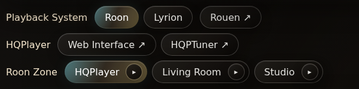

- **Roon / Lyrion** switches the whole page between the two players. The choice
  is kept in the browser.
- **Rouen**, **Web Interface** and **HQPTuner** are links, shown only when
  `ROUEN_URL`, `HQPLAYER_WEB_URL` or `HQPTUNER_URL` is set (the HQPlayer web
  interface is also found from the HQPlayerBridge plugin when Lyrion is in use).
- **Roon Zone** lists every zone as a pill instead of a drop-down. The ▸ on a
  pill opens that zone's [player card](#player-card).

## Now Playing

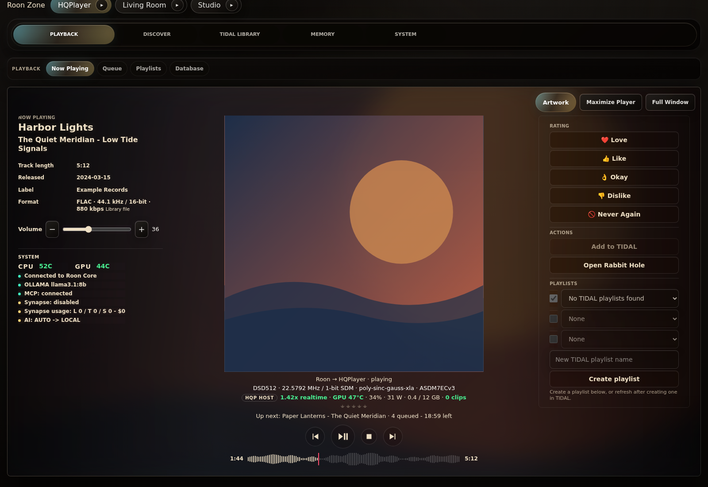

Roon and Lyrion share one three-column layout:

- **Left:** track length, release date, label and the source format (for
  example `FLAC · 44.1 kHz / 16-bit · 880 kbps`, with where it came from), a
  volume control, and a System block with CPU and GPU temperatures and the
  connection state of Roon or Lyrion, the language model and MCP.
- **Centre:** the album art, the playback chain under it (`Roon → HQPlayer ·
  playing`), rating stars, Up next, the transport and the seek bar.
- **Right:** rating buttons, actions and playlist tools.

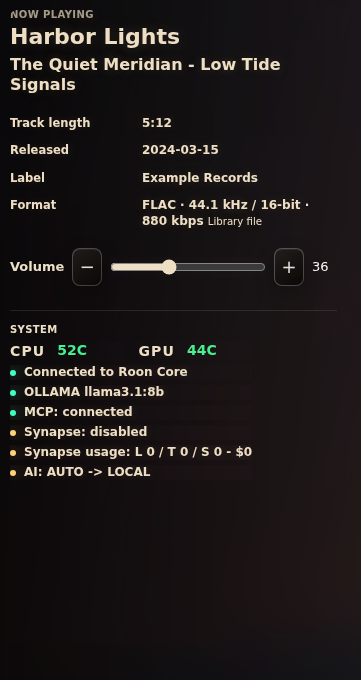

Temperature chips and the Visualizer toggle are hidden when they cannot work,
instead of showing empty values.

## Transport, Up next and the seek bar

Under the art, on both players:

- **Up next** names the next track, how many are queued and the time left.
- **Round icon buttons** for back, play/pause, stop and next.
- **A short seek bar.** When the track is a file in the Lyrion library (on
  either player), it is drawn as the track's waveform, read from the file with
  FFmpeg. Click or drag to seek; the red mark is the position.

## HQPlayer and the HQP host line

For a Roon zone that plays through HQPlayer (`ROON_HQPLAYER_ZONES`) or the
Lyrion HQPlayerBridge player, the line under the playback chain shows what
HQPlayer is doing: output rate, mode, filter and modulator.

If the HQPlayer machine runs the optional
[HQP host monitor](../integrations/hqp-host-monitor/README.md) and is listed in
`HQP_HOST_MONITORS`, an **HQP host** line follows it:

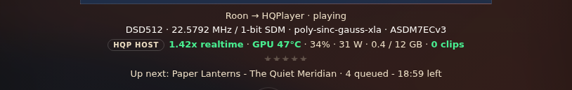

| Part | From | Colour |
|------|------|--------|
| `1.42x realtime` | HQPlayer's processing speed, shown only while playing | green from 1.1x, amber below 1.1x, red below 1.0x |
| `GPU 47°C` | the agent | green below 80 °C, amber from 80 °C, red from 90 °C |
| `34%`, `31 W`, `0.4 / 12 GB` | the agent: load, power, memory in use / total | |
| `0 clips` | HQPlayer's clip counter | green at 0, red above 0 |

Working hard, close to the limit:

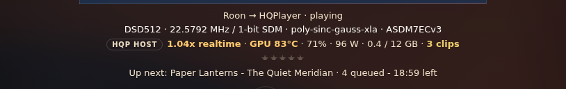

When the agent does not answer, the line says so in grey and keeps HQPlayer's
own numbers. A missing value is left out, never shown as 0:

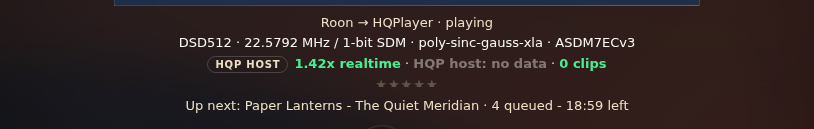

Zones and players that do not use a monitored HQPlayer show no host line at all.
When HQPlayer is stopped or paused, the realtime part is left out rather than
shown as a red 0.00x.

## Player card

The ▸ on any Roon zone or Lyrion player pill, or a tap on the album art, opens
that room's card: art, track, seek bar, back / play-pause / stop / next, and
volume with mute. It controls that room without switching the page to it.

  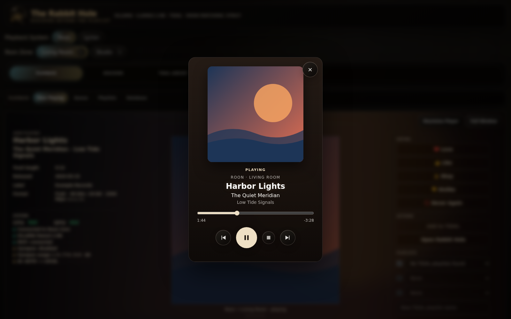
  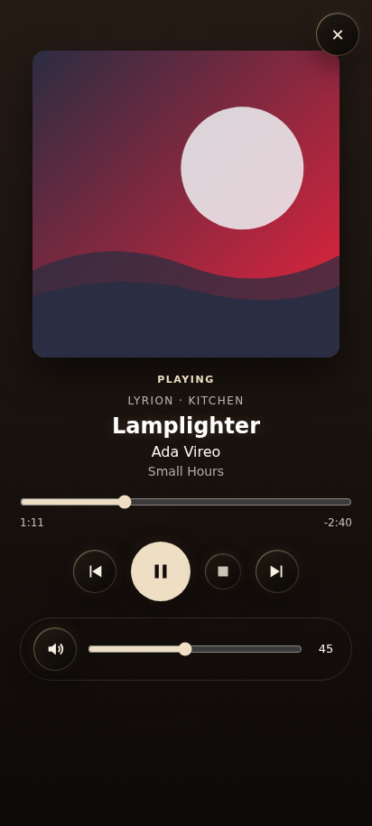

## Lyrion

Lyrion gets the same Now Playing as Roon, with what LMS knows about the file
(genre, track number, ReplayGain, file size, date added) and the player and
server under System:

A **Home** tab with new music, favorites and explore tiles:

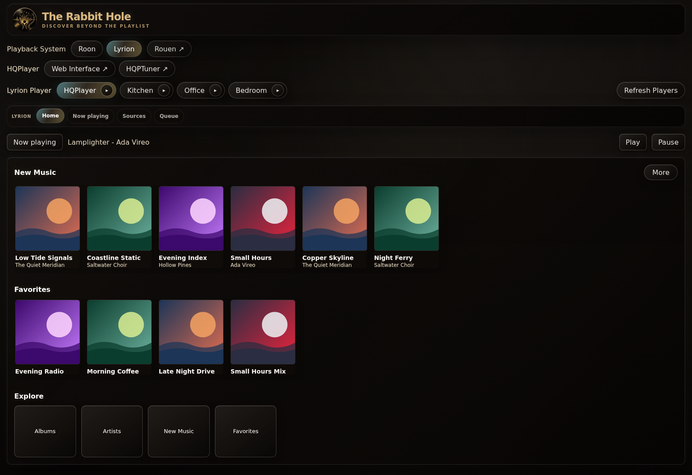

**Sources & Discovery** with foldable rows and the setup links moved into a
Setup menu:

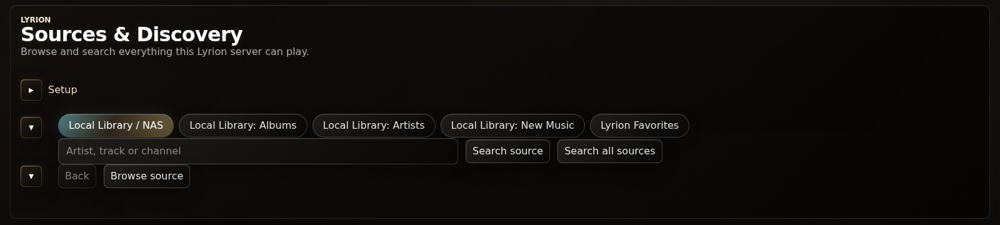

Lyrion tracks can be rated like Roon's, streamed tracks show their cover art,
and one unanswered Roon call no longer freezes the Lyrion controls.

## On a phone

The columns stack: details and System first, then the art and everything under
it.

  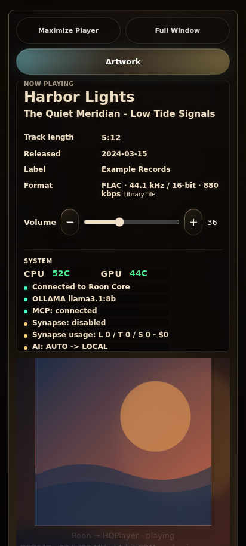
  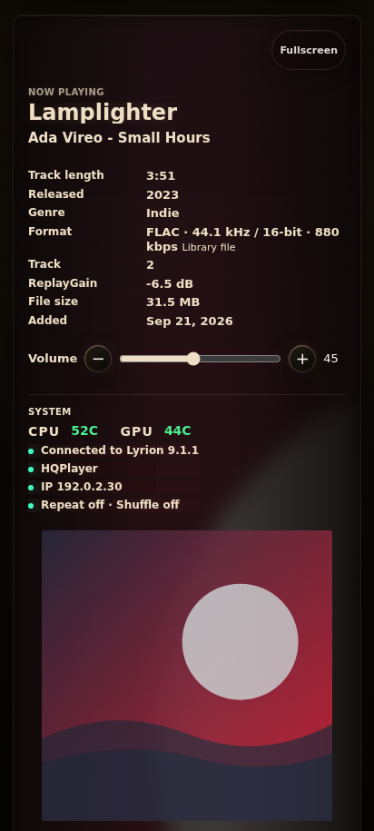

## Themes

Seven themes, picked in **Settings**. `UI_THEME` sets the default for new
browsers.

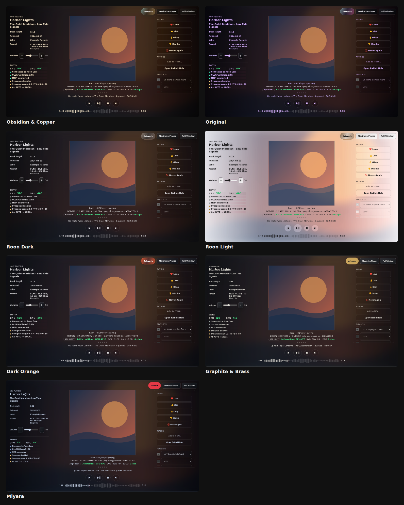

Each theme is a JSON file in `src/themes/`;
[Colour themes](../README.md#colour-themes) in the README explains how to add one.

## Changes you cannot see

- **Discovery:** artist-led TIDAL searches are checked against the planned
  artists, results that only echo a bare descriptor and karaoke backing tracks
  are rejected, and Last.fm relatives of the searched artist are kept.
- **Lyrion and HQPlayer:** HQPlayer is found from the bridge plugin's address,
  not a loopback player address.
- **Unraid:** a published image (`ghcr.io/guyp2k/rabbithole-fork`) and an Unraid
  template; see [Install on Unraid](../README.md#install-on-unraid).
